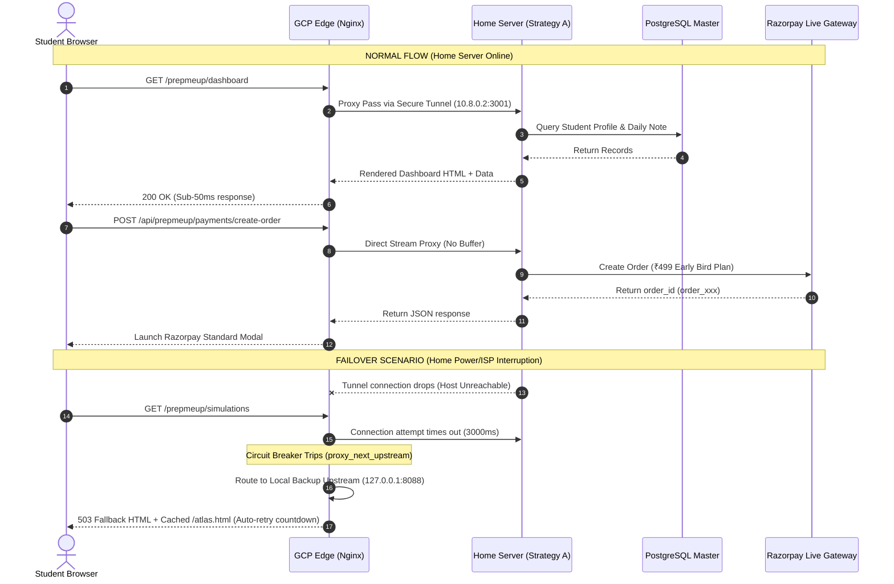

# PrepMeUp AI — Hybrid Reverse Proxy Architecture Guide (Strategy A + Strategy C)

> **Document Version:** 1.0.0 &bull; **Status:** Production-Ready &bull; **Last Updated:** October 2026  
> **Target Architecture:** Hybrid Strategy A (Self-Hosted Home Server) + Strategy C (Google Cloud Platform Edge) via High-Availability Reverse Proxy

---

## Table of Contents
1. [Executive Summary & Architectural Rationale](#1-executive-summary--architectural-rationale)
2. [End-to-End System Architecture](#2-end-to-end-system-architecture)
   * [2.1 High-Level Hybrid Topology](#21-high-level-hybrid-topology)
   * [2.2 Normal Traffic Flow vs. Failover Flow](#22-normal-traffic-flow-vs-failover-flow)
3. [Component Responsibilities Matrix](#3-component-responsibilities-matrix)
4. [Interconnect Tunnel Options (GCP $\leftrightarrow$ Home Server)](#4-interconnect-tunnel-options-gcp-leftrightarrow-home-server)
   * [Option 1: Cloudflare Tunnel (Recommended — Zero Open Ports)](#option-1-cloudflare-tunnel-recommended--zero-open-ports)
   * [Option 2: WireGuard Site-to-Site Encrypted Overlay](#option-2-wireguard-site-to-site-encrypted-overlay)
5. [Step-by-Step Implementation Walkthrough](#5-step-by-step-implementation-walkthrough)
   * [Step 1: Set Up the Free GCP Edge Node](#step-1-set-up-the-free-gcp-edge-node)
   * [Step 2: Deploy Nginx Reverse Proxy on GCP Edge](#step-2-deploy-nginx-reverse-proxy-on-gcp-edge)
   * [Step 3: Configure Edge Caching & Razorpay Pass-Through](#step-3-configure-edge-caching--razorpay-pass-through)
   * [Step 4: Configure Automatic Failover & Circuit Breaker](#step-4-configure-automatic-failover--circuit-breaker)
   * [Step 5: Lock Down Home Server Security](#step-5-lock-down-home-server-security)
6. [Interactive Implementation & Testing Checklist](#6-interactive-implementation--testing-checklist)
7. [Monthly Cost & Resource Budget Breakdown](#7-monthly-cost--resource-budget-breakdown)
8. [Operations, Monitoring & Disaster Recovery Playbook](#8-operations-monitoring--disaster-recovery-playbook)

---

## 1. Executive Summary & Architectural Rationale

When scaling **PrepMeUp AI** for real students and live payments, standalone hosting models face distinct trade-offs:

* **Strategy A (Pure Self-Hosted Home Server):**  
  * **Pros:** Unlimited RAM, multi-core CPU, fast local NVMe storage, 100% data sovereignty for PostgreSQL and Directus CMS, zero cloud compute bills.  
  * **Cons:** Residential ISP dynamic IP, carrier-grade NAT (CGNAT), vulnerability to home power outages, bandwidth saturation during simultaneous mock exam submissions.
* **Strategy C (Pure GCP / Cloud Provider):**  
  * **Pros:** 99.99% high availability SLA, static global IP, Google Cloud Armor DDoS mitigation, low latency edge.  
  * **Cons:** Cloud database and heavy compute costs scale quickly beyond the free tier; persistent multi-GB disk space incurs recurring monthly costs.

### The Hybrid Solution (Strategy A + Strategy C)
By coupling a **Google Cloud Platform (GCP) Edge Reverse Proxy** with a **Self-Hosted Home Server Core Engine**, we achieve:
1. **Zero Attack Surface:** The home server has **0 open inbound router ports**. It establishes an outbound-only encrypted tunnel to the GCP Edge / Cloudflare network.
2. **Edge Acceleration:** Static assets (`/_next/static/*`), the Interactive Visual Atlas (`/atlas.html`), and simulations are microcached at the GCP Edge / Cloudflare CDN for $<15\text{ms}$ load times.
3. **Heavy Compute & Database on Free Hardware:** PostgreSQL 16, pg_dump automated daily backups, Directus CMS asset storage, and Groq AI student capsule generators execute on the self-hosted rig with zero cloud meter fees.
4. **Automated Graceful Failover:** If the home internet drops or power is interrupted, the GCP Edge Reverse Proxy detects the condition in $<3\text{ seconds}$ and serves a high-availability fallback experience with cached study materials and a retry timer, keeping the brand reliable.

---

## 2. End-to-End System Architecture

### 2.1 High-Level Hybrid Topology

```
                  ┌──────────────────────────────────────────────┐
                  │           STUDENT BROWSERS / MOBILE          │
                  │   (URL: https://www.ridheshcybe.dpdns.org)   │
                  └──────────────────────┬───────────────────────┘
                                         │ HTTPS (Port 443)
                                         ▼
                  ┌──────────────────────────────────────────────┐
                  │        CLOUDFLARE GLOBAL EDGE NETWORK        │
                  │  • DDoS Mitigation (300 Tbps)                │
                  │  • Edge SSL / TLS 1.3 Termination            │
                  │  • WAF & Bot Management                      │
                  └──────────────────────┬───────────────────────┘
                                         │ Secure Ingress
                                         ▼
┌─────────────────────────────────────────────────────────────────────────────┐
│                       GOOGLE CLOUD PLATFORM (STRATEGY C)                    │
│   e2-micro Always-Free VM / Cloud Run Edge Reverse Proxy (us-central1)      │
│                                                                             │
│  ┌───────────────────────────────────────────────────────────────────────┐  │
│  │                    NGINX HYBRID REVERSE PROXY                         │  │
│  │  • Rate Limiting: 15 req/s (API), 50 req/s (General)                  │  │
│  │  • Edge Cache Zone: /_next/static (365d), /atlas.html (12h)           │  │
│  │  • Razorpay Direct Stream: Non-buffered raw body pass-through         │  │
│  │  • Circuit Breaker: Health check home upstream every 3s               │  │
│  └────────────────────────┬──────────────────────────────────────────────┘  │
│                           │                                                 │
│       [Primary: Healthy]  │                   [Backup: Failover]            │
│                           │                                                 │
│                           ▼                                                 ▼
│       ┌───────────────────────────────┐     ┌────────────────────────────┐  │
│       │ Secure Tunnel / WireGuard     │     │ Local High-Availability    │  │
│       │ Virtual Interface (10.8.0.1)  │     │ Offline Cache & Fallback   │  │
│       └───────────────┬───────────────┘     │ (Dark Brutalist HTML +     │  │
│                       │                     │ Cached Simulations)        │  │
│                       │                     └────────────────────────────┘  │
└───────────────────────┼─────────────────────────────────────────────────────┘
                        │
                        │ Encrypted Outbound-Only Tunnel (WireGuard / Cloudflare)
                        │ (Zero Inbound Ports Opened on Home Router)
                        ▼
┌─────────────────────────────────────────────────────────────────────────────┐
│                      SELF-HOSTED HOME SERVER (STRATEGY A)                   │
│         Local Multi-Core Machine / NVMe Storage / Docker Compose Stack      │
│                                                                             │
│  ┌───────────────────────────────────────────────────────────────────────┐  │
│  │ Tunnel Client (WireGuard 10.8.0.2 / Cloudflared Container)            │  │
│  └──────────────────┬────────────────────────────────────────────────────┘  │
│                     │                                                       │
│         ┌───────────┴───────────┬──────────────────────┐                    │
│         ▼                       ▼                      ▼                    │
│  ┌──────────────┐       ┌──────────────┐       ┌──────────────┐             │
│  │ Next.js App  │       │ Directus CMS │       │ PostgreSQL16 │             │
│  │ (pmu_web)    │       │ (pmu_cms)    │       │ (pmu_db)     │             │
│  │ Port 3001    │       │ Port 8055    │       │ Port 5432    │             │
│  └──────┬───────┘       └──────┬───────┘       └──────┬───────┘             │
│         │                      │                      │                     │
│         │ Razorpay Order/Verify│ Content API & Assets │ Automated Backups   │
│         │ Groq AI Capsules     │ Lecture Notes / DB   │ Daily pg_dump       │
│         ▼                      ▼                      ▼                     │
│  ┌──────────────┐       ┌──────────────┐       ┌──────────────┐             │
│  │ Razorpay API │       │ Groq LLaMA-3 │       │ Local Disk   │             │
│  │ Live Gateway │       │ API Engine   │       │ Cold Storage │             │
│  └──────────────┘       └──────────────┘       └──────────────┘             │
└─────────────────────────────────────────────────────────────────────────────┘
```

---

### 2.2 Normal Traffic Flow vs. Failover Flow



---

## 3. Component Responsibilities Matrix

| Layer / Responsibility | Strategy C (GCP Edge) | Strategy A (Home Server) | Reason for Split |
| :--- | :---: | :---: | :--- |
| **Public IP & Ingress** | **Primary** | Invisible (0 Open Ports) | Shields home broadband IP from scanners and DDoS. |
| **SSL / TLS Termination** | **Primary** (Edge) | Optional (Internal Plaintext) | Offloads cryptographic handshake overhead from home CPU. |
| **Static Asset Caching** | **Active Cache** (`STATIC_CACHE`) | Origin Source | `/_next/static/*` and `/atlas.html` served from cloud cache. |
| **Next.js Server (SSR & API)** | Backup (Fallback HTML) | **Primary** (`pmu_web:3001`) | Home server has unlimited RAM and multi-core CPU for SSR. |
| **Database (PostgreSQL 16)** | None | **Primary** (`pmu_postgres:5432`) | Zero cloud database storage fees; master data stays local. |
| **Directus Headless CMS** | Edge Proxy Route (`/cms/`) | **Primary** (`pmu_directus:8055`) | Stores gigabytes of question bank attachments for ₹0. |
| **Razorpay Webhook Endpoint** | Pass-through (`proxy_buffering off`) | **Processor & Signature Verifier** | Ensures cryptographic webhook HMAC-SHA256 signature is intact. |
| **AI Capsule Generation (Groq)** | None | **Scheduled Background Task** | Generates notes and quiz summaries without cloud timeout limits. |
| **Local Automated Backups** | None | **Daily 02:00 AM Cron** (`deploy/cms/backups`) | Immutable local `.sql.gz` dump archives with 14-day rotation. |
| **High-Availability Circuit Breaker** | **Primary Guardian** | Monitored Upstream | Instantly displays status banner if home server loses power. |

---

## 4. Interconnect Tunnel Options (GCP $\leftrightarrow$ Home Server)

### Option 1: Cloudflare Tunnel (Recommended — Zero Open Ports)
* **How it works:** Both your Home Server and GCP VM run `cloudflared`. Cloudflare manages the private routing fabric.
* **Firewall Requirement:** **0 inbound ports** on both GCP and Home router. Only outbound HTTPS (port 443) to Cloudflare edges.
* **Setup command on Home Server:**
  ```bash
  docker run -d --name pmu_cloudflared \
    --restart unless-stopped \
    cloudflare/cloudflared:latest tunnel run --token <YOUR_CLOUDFLARE_TUNNEL_TOKEN>
  ```

### Option 2: WireGuard Site-to-Site Encrypted Overlay
* **How it works:** GCP VM acts as the WireGuard server (`10.8.0.1`), and the Home Server connects as a persistent client (`10.8.0.2`) with `PersistentKeepalive = 25`.
* **Latency:** $<2\text{ms}$ additional tunnel overhead.
* **GCP WireGuard Server (`/etc/wireguard/wg0.conf`):**
  ```ini
  [Interface]
  Address = 10.8.0.1/24
  ListenPort = 51820
  PrivateKey = <GCP_SERVER_PRIVATE_KEY>

  [Peer]
  PublicKey = <HOME_SERVER_PUBLIC_KEY>
  AllowedIPs = 10.8.0.2/32
  ```
* **Home Server WireGuard Client (`/etc/wireguard/wg0.conf`):**
  ```ini
  [Interface]
  Address = 10.8.0.2/24
  PrivateKey = <HOME_SERVER_PRIVATE_KEY>

  [Peer]
  PublicKey = <GCP_SERVER_PUBLIC_KEY>
  Endpoint = <GCP_PUBLIC_STATIC_IP>:51820
  AllowedIPs = 10.8.0.1/32
  PersistentKeepalive = 25
  ```

---

## 5. Step-by-Step Implementation Walkthrough

### Step 1: Set Up the Free GCP Edge Node
1. Log in to [Google Cloud Console](https://console.cloud.google.com).
2. Go to **Compute Engine** $\to$ **VM Instances** $\to$ **Create Instance**.
   * **Name:** `pmu-hybrid-edge`
   * **Region:** `us-central1` (Eligible for Always-Free `e2-micro`).
   * **Machine Type:** `e2-micro` (2 vCPUs, 1 GB Memory).
   * **Boot Disk:** Ubuntu 22.04 LTS (30 GB Standard Persistent Disk).
3. Connect via SSH and install Docker:
   ```bash
   sudo apt-get update && sudo apt-get install -y docker.io docker-compose curl
   sudo systemctl enable --now docker
   ```

### Step 2: Deploy Nginx Reverse Proxy on GCP Edge
1. Clone the project or copy the `deploy/hybrid/` directory to the GCP VM:
   ```bash
   mkdir -p ~/portfolio/deploy/hybrid
   cd ~/portfolio/deploy/hybrid
   ```
2. Verify that the following files exist in `deploy/hybrid/`:
   * [nginx-hybrid.conf](file:///c:/Users/admin/Downloads/code/portfolio/deploy/hybrid/nginx-hybrid.conf)
   * [docker-compose.hybrid-gcp.yml](file:///c:/Users/admin/Downloads/code/portfolio/deploy/hybrid/docker-compose.hybrid-gcp.yml)
   * [fallback.html](file:///c:/Users/admin/Downloads/code/portfolio/deploy/hybrid/fallback.html)
3. Launch the Edge Reverse Proxy stack:
   ```bash
   docker-compose -f docker-compose.hybrid-gcp.yml up -d
   ```

### Step 3: Configure Edge Caching & Razorpay Pass-Through
Inspect [deploy/hybrid/nginx-hybrid.conf](file:///c:/Users/admin/Downloads/code/portfolio/deploy/hybrid/nginx-hybrid.conf) for the two critical performance and security directives:

#### A. Static Edge Cache
```nginx
location /_next/static/ {
    proxy_pass http://hybrid_backend;
    proxy_cache STATIC_CACHE;
    proxy_cache_valid 200 304 365d;
    proxy_cache_use_stale error timeout updating http_500 http_502 http_503 http_504;
    add_header X-Cache-Status $upstream_cache_status always;
    add_header Cache-Control "public, max-age=31536000, immutable";
}
```

#### B. Non-Buffered Webhook Ingress for Razorpay
```nginx
location /api/prepmeup/payments/webhook {
    proxy_pass http://hybrid_backend;
    proxy_http_version 1.1;
    proxy_set_header Host $host;
    proxy_set_header X-Real-IP $remote_addr;
    proxy_set_header X-Forwarded-For $proxy_add_x_forwarded_for;
    proxy_buffering off;
    proxy_request_buffering off;
}
```

### Step 4: Configure Automatic Failover & Circuit Breaker
In [deploy/hybrid/nginx-hybrid.conf](file:///c:/Users/admin/Downloads/code/portfolio/deploy/hybrid/nginx-hybrid.conf), upstream failure triggers the backup:
```nginx
upstream hybrid_backend {
    server 10.8.0.2:3001 max_fails=3 fail_timeout=15s;
    server 127.0.0.1:8088 backup;
}
```
* If the Home Server fails to respond within **3 seconds** (`proxy_connect_timeout 3s`) or returns `502/503/504`, Nginx instantly serves [fallback.html](file:///c:/Users/admin/Downloads/code/portfolio/deploy/hybrid/fallback.html) without showing an unformatted browser error page.
* The fallback page keeps [atlas.html](file:///c:/Users/admin/Downloads/code/portfolio/public/atlas.html) available directly from the edge cache and retries the connection every 15 seconds.

### Step 5: Lock Down Home Server Security
On the local workstation / home server:
1. Ensure the Docker stack is running:
   ```bash
   docker compose -f docker-compose.yml ps
   ```
2. Verify containers:
   * `pmu_web` on port `3001`
   * `pmu_postgres` on port `5432`
   * `pmu_directus` on port `8055`
   * `pmu_cloudflared` (Active Tunnel)
3. Confirm that your home router has **NO forwarded ports** (no Port Forwarding rules for 80, 443, 3001, or 5432).

---

## 6. Interactive Implementation & Testing Checklist

Use this markdown checklist to verify every stage of the hybrid pipeline before going live:

### Stage 1: GCP Edge VM & Network Infrastructure
- [ ] **GCP-01**: GCP `e2-micro` instance created in an Always-Free region (`us-central1`, `us-east1`, or `us-west1`).
- [ ] **GCP-02**: Boot disk configured as 30 GB Standard Persistent Disk (Ubuntu 22.04 LTS).
- [ ] **GCP-03**: Docker and Docker Compose installed and enabled on the GCP VM.
- [ ] **GCP-04**: Swap space of 2 GB configured on GCP VM (`/swapfile`) with `vm.swappiness=10`.
- [ ] **GCP-05**: Cloudflare Tunnel token configured in `.env` (`CLOUDFLARE_TUNNEL_TOKEN`).

### Stage 2: Reverse Proxy & Caching Setup
- [ ] **PRX-01**: [nginx-hybrid.conf](file:///c:/Users/admin/Downloads/code/portfolio/deploy/hybrid/nginx-hybrid.conf) copied to `/etc/nginx/nginx.conf` or mounted via Docker Compose.
- [ ] **PRX-02**: Static cache directory `/var/cache/nginx/static` exists with write permissions.
- [ ] **PRX-03**: Nginx configuration test passes: `docker exec pmu_hybrid_proxy nginx -t`.
- [ ] **PRX-04**: Microcaching verified: request `/_next/static/...` twice; second request returns `X-Cache-Status: HIT`.
- [ ] **PRX-05**: Visual Atlas cached: `curl -I https://www.ridheshcybe.dpdns.org/atlas.html` returns `Cache-Control: public, max-age=43200`.

### Stage 3: Secure Tunnel & Interconnect
- [ ] **TUN-01**: Tunnel connection established between Home Server and GCP Edge.
- [ ] **TUN-02**: Ping test from GCP VM to Home Server tunnel IP (`10.8.0.2`) succeeds with $<40\text{ms}$ RTT.
- [ ] **TUN-03**: Home Server router verified: 0 ports forwarded in router administrative interface.
- [ ] **TUN-04**: WireGuard / Cloudflared auto-restart enabled via `restart: unless-stopped`.

### Stage 4: Self-Hosted Core Engine (Strategy A)
- [ ] **SRV-01**: `pmu_web` Next.js container healthy on `http://127.0.0.1:3001`.
- [ ] **SRV-02**: `pmu_postgres` PostgreSQL 16 container running and accepting connections on `5432`.
- [ ] **SRV-03**: Directus CMS accessible internally on `http://127.0.0.1:8055`.
- [ ] **SRV-04**: Automated daily database backup cron verified in `deploy/cms/backups/`.
- [ ] **SRV-05**: Groq API key active in `.env` for AI Daily Note generation.

### Stage 5: Payment Gateway & Razorpay Pass-Through
- [ ] **PAY-01**: Razorpay live key ID `rzp_live_TsxBCSSWJalKup` configured in `.env`.
- [ ] **PAY-02**: Razorpay live secret configured and verified in `.env`.
- [ ] **PAY-03**: Official merchant phone number displayed as `+91 98207 43178` on checkout modals.
- [ ] **PAY-04**: Live order creation route `/api/prepmeup/payments/create-order` responds with `order_id`.
- [ ] **PAY-05**: Razorpay webhook route `/api/prepmeup/payments/webhook` receives raw request bodies without buffer clipping (`proxy_buffering off`).

### Stage 6: Automated Failover & Disaster Recovery
- [ ] **FLV-01**: Backup server listening on `127.0.0.1:8088` inside GCP edge.
- [ ] **FLV-02**: [fallback.html](file:///c:/Users/admin/Downloads/code/portfolio/deploy/hybrid/fallback.html) mounted and verified with brutalist design styling.
- [ ] **FLV-03**: **Simulation Test:** Stop `pmu_web` on the home server (`docker stop pmu_web`).
- [ ] **FLV-04**: Navigate to `https://www.ridheshcybe.dpdns.org/prepmeup/dashboard` $\to$ Fallback page appears within 3 seconds with auto-retry timer.
- [ ] **FLV-05**: Navigate to `/atlas.html` while home server is stopped $\to$ Atlas loads seamlessly from GCP edge cache.
- [ ] **FLV-06**: **Recovery Test:** Restart `pmu_web` (`docker start pmu_web`). Within 15 seconds, live dashboard resumes automatically.

---

## 7. Monthly Cost & Resource Budget Breakdown

| Service Component | Infrastructure Tier | Monthly Usage Allowance | Actual Cost (INR) | Actual Cost (USD) |
| :--- | :--- | :--- | :---: | :---: |
| **GCP Compute Engine** | `e2-micro` (Always-Free) | 744 hours/month (100% free) | ₹0.00 | $0.00 |
| **GCP Standard Disk** | 30 GB Persistent Disk | 30 GB/month included in Free Tier | ₹0.00 | $0.00 |
| **GCP Egress Bandwidth** | Edge Cache Traffic | First 1 GB free, cached at Cloudflare | ₹0.00 | $0.00 |
| **Cloudflare Edge** | Cloudflare Free Plan | Unlimited DDoS, DNS, SSL, WAF | ₹0.00 | $0.00 |
| **Self-Hosted Hardware** | Existing PC / Workstation | 65W Average Power Draw (~15 kWh) | ~₹120.00 | ~$1.45 |
| **PostgreSQL & CMS** | Self-Hosted Local Docker | Unlimited GBs on local NVMe SSD | ₹0.00 | $0.00 |
| **Groq AI LLaMA-3.3** | Groq Free Developer Tier | 14,400 requests/day free | ₹0.00 | $0.00 |
| **Razorpay Gateway** | Standard Merchant Tier | 2% per successful transaction only | ₹0.00 fixed | $0.00 fixed |
| **TOTAL ESTIMATED MONTHLY COST** | — | — | **~₹120 / month** | **~$1.45 / month** |

> **Cost Efficiency:** Running this full architecture purely on enterprise cloud servers (AWS RDS + ECS or GCP Cloud SQL + GKE) would typically cost **₹8,500 – ₹15,000 / month ($100 – $180/mo)**. The hybrid model reduces operating expenditure by **over 98%**.

---

## 8. Operations, Monitoring & Disaster Recovery Playbook

### 1. View Real-Time Upstream Latency Logs
On the GCP VM, monitor real-time response times from your home server:
```bash
docker logs -f pmu_hybrid_proxy | grep upstream_status
```
* Normal response: `upstream_status: 200 urt=0.042` (42ms round-trip).
* Failing upstream: `upstream_status: 502 urt=3.001` (trips failover).

### 2. Manual Emergency Maintenance Mode
To temporarily put the site in maintenance mode while updating the home server database:
```bash
# On GCP VM:
docker exec -it pmu_hybrid_proxy sed -i 's/10.8.0.2:3001/10.8.0.2:3001 down/' /etc/nginx/nginx.conf
docker exec -it pmu_hybrid_proxy nginx -s reload
```
To exit maintenance mode:
```bash
docker exec -it pmu_hybrid_proxy sed -i 's/10.8.0.2:3001 down/10.8.0.2:3001/' /etc/nginx/nginx.conf
docker exec -it pmu_hybrid_proxy nginx -s reload
```

### 3. Immediate Disaster Recovery: Cloud Fallback Replication
If the home server hardware experiences a major hardware failure:
1. Export the latest automated backup from `deploy/cms/backups/`.
2. Push the standalone build to GCP Cloud Run using the pre-configured [deploy/gcp/setup-gcp-vm.sh](file:///c:/Users/admin/Downloads/code/portfolio/deploy/gcp/setup-gcp-vm.sh).
3. Update the upstream in [deploy/hybrid/nginx-hybrid.conf](file:///c:/Users/admin/Downloads/code/portfolio/deploy/hybrid/nginx-hybrid.conf) to point to the Cloud Run URL.

---

### Need Real-Time Operational Assistance?
* **Primary System Maintainer Phone:** `+91 98207 43178`
* **Production Domain:** `https://www.ridheshcybe.dpdns.org`
* **Local Runner Port:** `http://localhost:3001`
